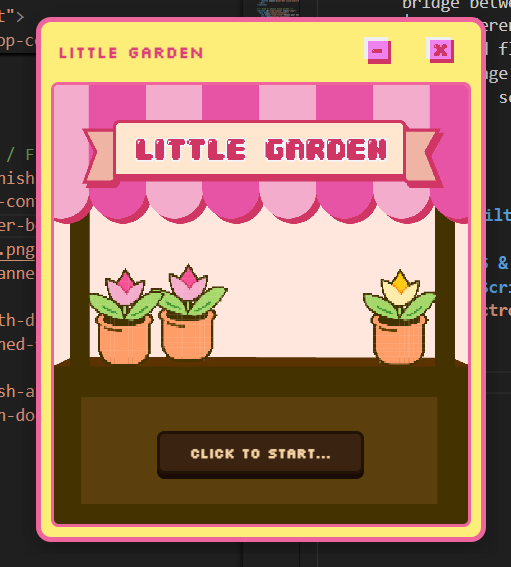
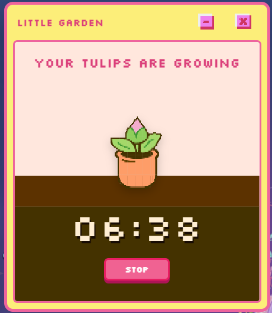

# 🌱 Little Garden

> A cozy pixel-art Pomodoro & Focus Timer desktop application built with Electron. Grow your own flowers while staying productive! 🌷✨

---

## 📖 About The Project

**Little Garden** is a desktop focus timer designed to make work and study sessions peaceful and rewarding. As you stay focused and your timer counts down, your tulip gradually blossoms across different growth stages.

---

## 📸 Screenshots & Preview

<p align="center">
  
  &nbsp;&nbsp;
  
</p>

---

## ✨ Features

- ⏱️ **Pomodoro & Focus Timer**: Customizable work and break intervals to keep you productive.
- 🌷 **Flower Growth Stages**: Watch your pixel tulip sprout and bloom as you complete your focus sessions.
- 🎨 **Charming Pixel Art**: Cozy, retro aesthetic designed for a calming workspace.
- 🖥️ **Lightweight Desktop App**: Runs cleanly on your desktop powered by Electron.

---

## 🚀 Getting Started

Follow these instructions to set up and run the project locally on your machine.

### Prerequisites

Ensure you have [Node.js](https://nodejs.org/) (LTS recommended) installed on your system.

### Installation

1. **Clone the repository:**

   ```bash
   git clone https://github.com/<your-username>/LittleGarden.git
   ```

2. **Navigate into the project directory:**

   ```bash
   cd LittleGarden
   ```

3. **Install dependencies:**

   ```bash
   npm install
   ```

4. **Launch the application:**
   ```bash
   npm start
   ```

---

## 📁 Project Structure

```text
LittleGarden/
├── BG/                     # Background scenes and pixel assets
├── button/                 # UI buttons and interactive icons
├── ScreenShots/            # Screenshots and preview media
├── tulips/                 # Flower growth stage sprite sheets
├── index.html              # Main application window structure
├── style.css               # Styling and pixel art UI theme
├── main.js                 # Electron main process (lifecycle & windows)
├── preload.js              # Secure bridge between main and renderer
├── renderer.js             # Timer logic and flower growth controller
└── package.json            # Project manifest, scripts, and dependencies
```

---

